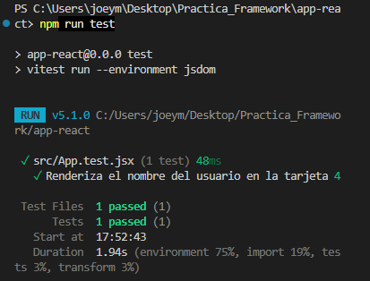
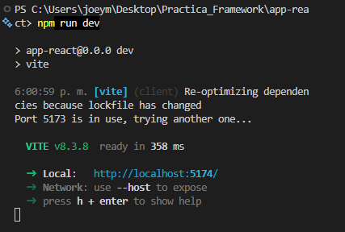
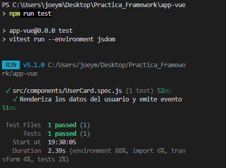
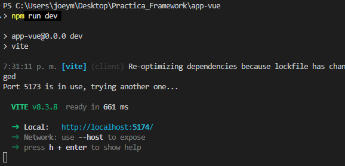

# Práctica - Desarrollo Interactivo de App parte 3

Esta práctica contiene la misma aplicación desarrollada en dos frameworks distintos: React y Vue.

## 1. App en React
**Ruta:** `/app-react`

**Instrucciones para ejecutar:**
1. Navegar a la carpeta: `cd app-react`
2. Instalar dependencias: `npm install`
3. Ejecutar pruebas: `npm run test`
4. Iniciar el servidor: `npm run dev`

## 2. App en Vue
**Ruta:** `/app-vue`

**Instrucciones para ejecutar:**
1. Navegar a la carpeta: `cd app-vue`
2. Instalar dependencias: `npm install`
3. Iniciar el servidor: `npm run dev`
4. Ejecutar pruebas: `npm run test`

## Evidencias
React

Vue

